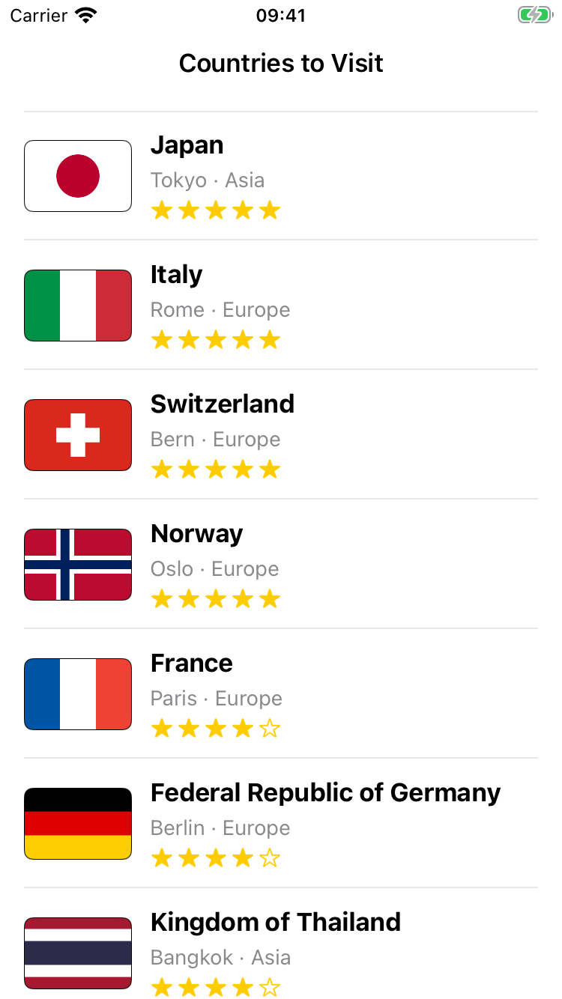
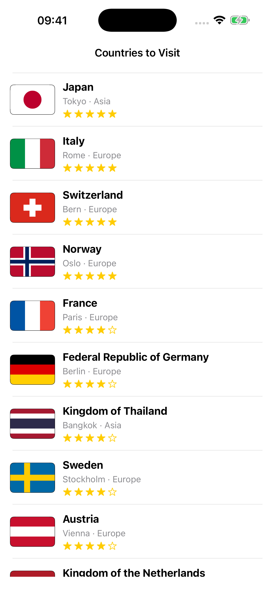

# Lab: Favorites List — UITableView & Custom Cells

A UIKit app that shows 20 countries I want to visit in a `UITableView` with a custom cell.
Each row has the country flag, the name, the capital and continent, and a rating from 0 to 5 stars.

## Screenshots

| iPhone SE (3rd gen) | iPhone 16 Pro Max |
|:---:|:---:|
|  |  |

## Demo

[Screen recording](Screenshots/demo.mov): scrolling through the whole list.

## Data

- `FavoriteItem` struct with `title`, `subtitle`, `imageName`, `rating`
- All 20 items are in `FavoritesData` (`FavoriteItem.swift`)
- Every country has its own flag image in `Assets.xcassets`

## Custom cell

- `FavoriteCell` (`FavoriteCell.swift`) is a `UITableViewCell` subclass with only `@IBOutlet`s and a `configure(with:)` method
- Outlets: flag image, title label, subtitle label and an outlet collection of 5 star image views
- Stars use `star.fill` / `star` SF Symbols, filled ones show the rating
- The cell is fully set from its item every time it is dequeued, so reused cells never show old data

## Table view

- One screen with a `UITableView` pinned to the Safe Area, inside a navigation controller
- The prototype cell has class `FavoriteCell` and reuse identifier `FavoriteCell`
- `ViewController` implements `UITableViewDataSource`, returns one row per item and dequeues cells with `dequeueReusableCell(withIdentifier:for:)`

## Layout

All layout is in `Main.storyboard`, there is no layout code in Swift.

- Flag image on the left: fixed 72×48, 16 pt from the leading edge, vertically centered
- Vertical stack to the right of the image: title, subtitle and the rating row
- Rating row: horizontal stack with 5 star images (16×16) and a spacer view
- The stack is pinned top/bottom 12 pt and trailing 16 pt, so the cell height follows its content
- The title has `Lines = 0`, so long names wrap instead of overlapping the image or going off screen

## Running

Open `FavoritesList.xcodeproj`, choose an iPhone simulator and press Run (⌘R). No extra setup is needed.
