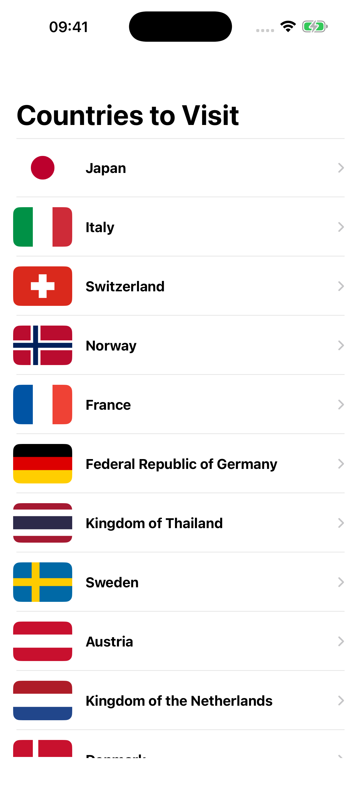
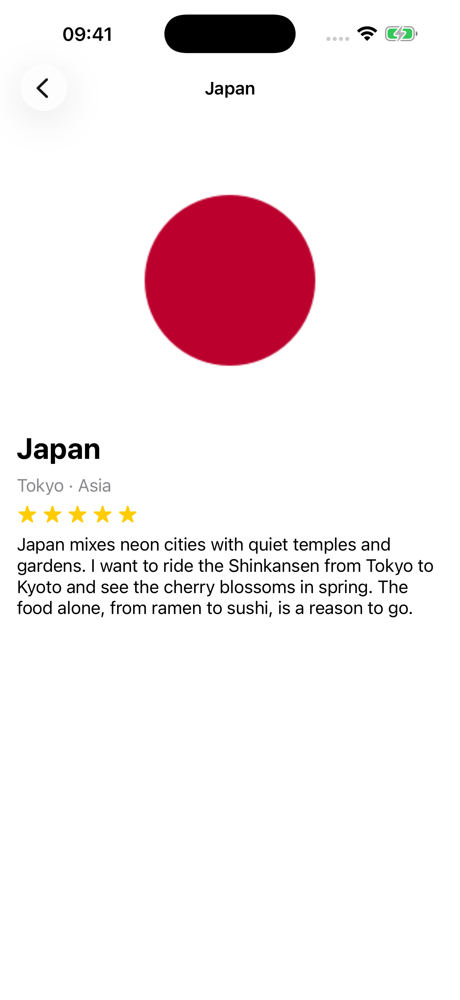
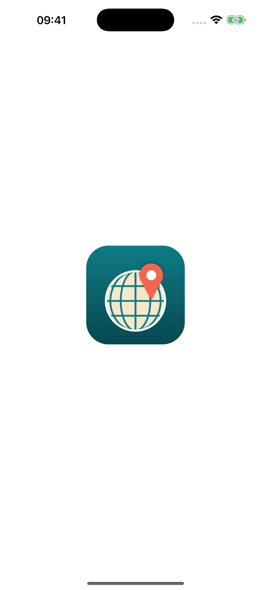
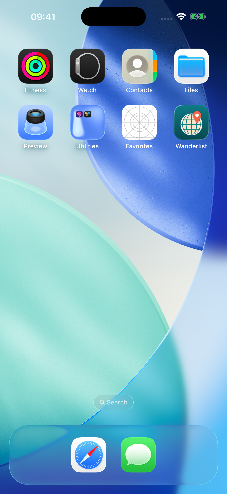
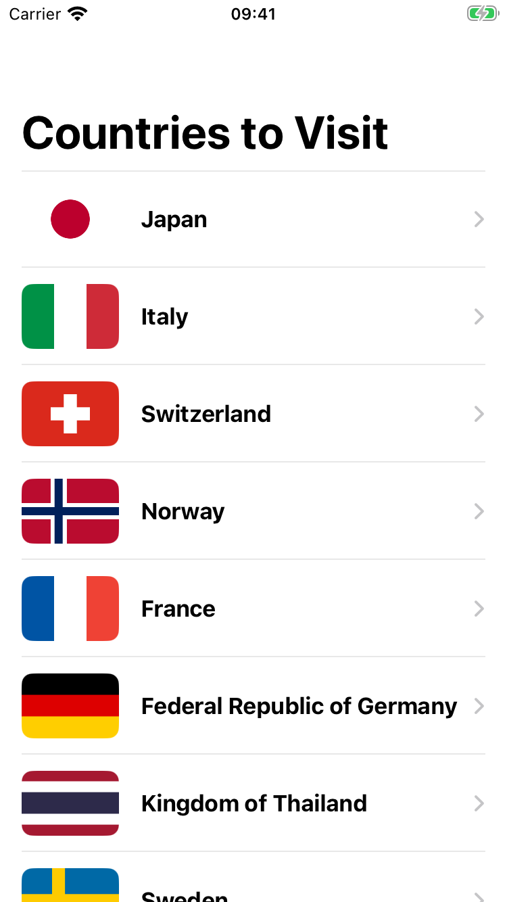
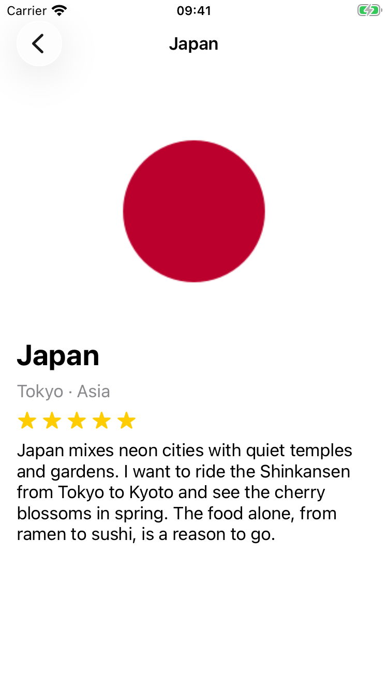

# Lab: Favorites Navigator — UINavigationController & Detail Screen

**Name:** Magzhan
**Theme:** Countries I want to visit

Wanderlist is a UIKit app with a list of 20 countries I want to visit. The list lives inside a `UINavigationController`. Tapping a row opens a Detail screen with the country's flag, name, capital and continent, a rating from 0 to 5 stars and a short description of why I want to go there.

## Screenshots

| List | Detail | Launch Screen | App Icon |
|:---:|:---:|:---:|:---:|
|  |  |  |  |

| iPhone SE (3rd gen) · List | iPhone SE (3rd gen) · Detail |
|:---:|:---:|
|  |  |

## Data

- `FavoriteItem` struct with `title`, `subtitle`, `imageName`, `rating` and `description`
- All 20 items are in `FavoritesData` (`FavoriteItem.swift`)
- Every country has its own flag image in `Assets.xcassets`

## Storyboard

Everything is built in `Main.storyboard`: there is no layout or navigation code in Swift.

- The Navigation Controller is the initial view controller, with Prefers Large Titles on
- The list screen ("Countries to Visit") has a `UITableView` pinned to the Safe Area and a prototype cell `FavoriteCell` that shows only the flag and the title
- A Show segue with identifier `showDetail` goes from the prototype cell to the Detail screen
- The Detail screen uses a small title (Large Title = Never) and a scroll view with a vertical stack: flag (3:2, Aspect Fill, clips to bounds), title, subtitle, 5 star SF Symbols and the description (`Lines = 0`)

## Passing data

- `DetailViewController` has one property, `var item: FavoriteItem?`
- `ViewController.prepare(for:sender:)` checks the segue identifier, casts `segue.destination` and takes the row from `tableView.indexPathForSelectedRow`
- The Detail screen fills its own outlets and title in `viewDidLoad`
- The selected row is deselected in `viewWillAppear` when coming back to the list

## App Icon and Launch Screen

- `AppIcon` is a single 1024×1024 PNG without transparency (a globe with a map pin), drawn by `Design/draw-icon.swift`
- `LaunchScreen.storyboard` shows the icon art centered with constraints on the system background color, so it works in Light and Dark Mode

## Running

Open `FavoritesNavigator.xcodeproj`, choose an iPhone simulator and press Run (⌘R).
