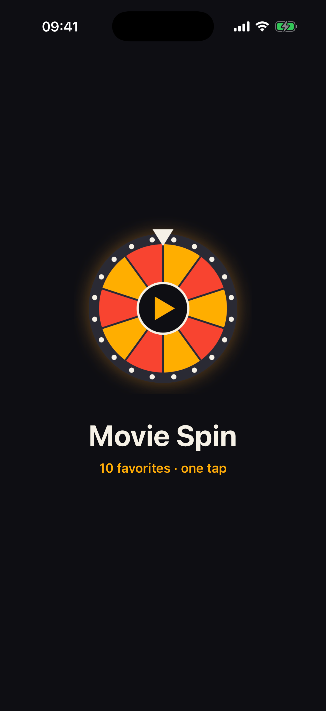
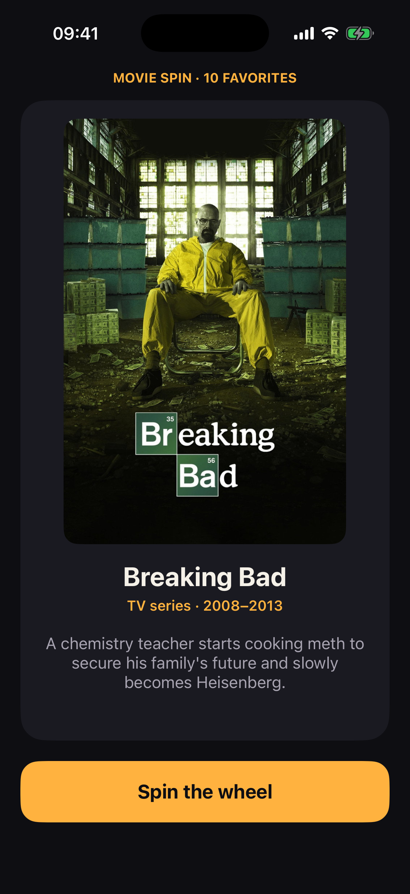
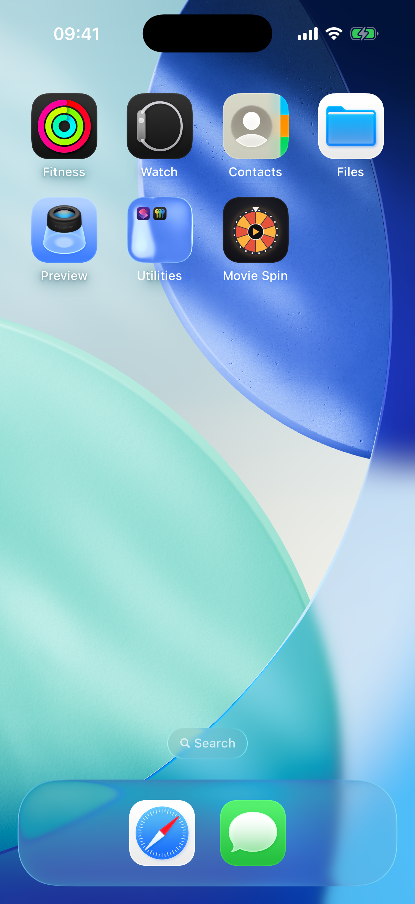

# Lab 6 · Favorites Roulette — Movie Spin

A single-screen iOS app that shows a random card from my 10 favorite movies and TV series.
Each tap on **Spin the wheel** shows a new favorite with its poster, title, year and a short description.
The same favorite never appears twice in a row.

## Screenshots

| Launch screen | Main screen | Home Screen with icon |
|:---:|:---:|:---:|
|  |  |  |

## Favorites (category: movies & series)

1. Breaking Bad
2. Better Call Saul
3. Spider-Man: No Way Home
4. Supernatural
5. Game of Thrones
6. Interstellar
7. The Dark Knight
8. Inception
9. Peaky Blinders
10. Stranger Things

## How it works

- **Data:** `Favorite.swift` defines `struct Favorite` (title, subtitle, description, image name). `Favorite.all` is an array of exactly 10 favorites. Every poster is in `Assets.xcassets`.
- **Layout:** built in `Main.storyboard` with a `UIImageView`, `UILabel`s and a `UIButton`. Auto Layout is turned off, and views use frames with autoresizing masks (no constraints in any storyboard).
- **Initial state:** on launch, the card shows a roulette wheel placeholder and an intro text instead of empty views.
- **Behavior:** `ViewController.swift` picks a random index with `Int.random(in:)` and keeps picking until it differs from the one on screen. Then it updates the image, title, subtitle and description together in one cross-dissolve animation.
- **No force unwraps** except the `@IBOutlet` declarations.
- **Launch screen:** `LaunchScreen.storyboard` uses the same dark background, roulette logo and amber accent as the app.
- **App icon:** custom 1024 × 1024 PNG without transparency.

## Run

Open `MovieSpin.xcodeproj` in Xcode, choose an iPhone simulator and press **Run** (⌘R).

Poster images: [TMDB](https://www.themoviedb.org), used for this class assignment only.
