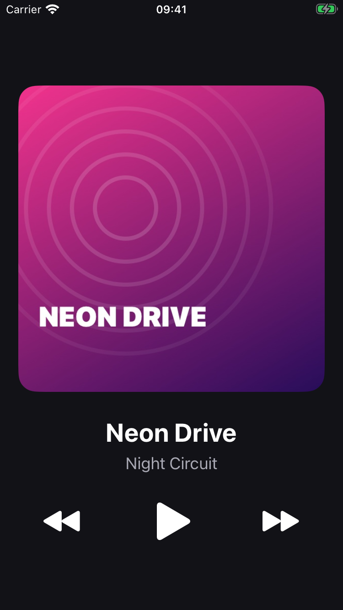
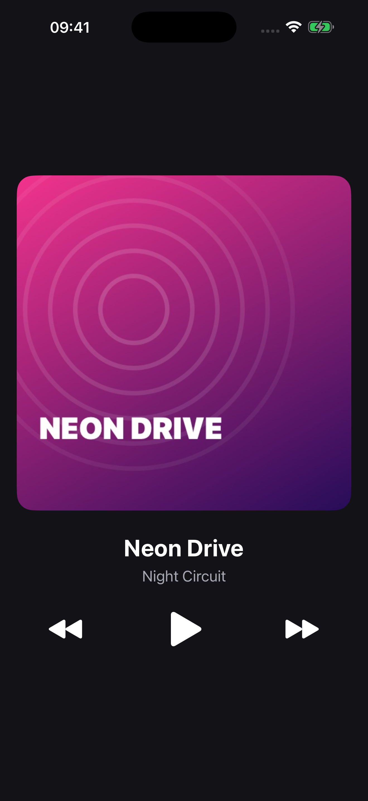

# Lab: Music Player — UIStackView & Auto Layout

A single-screen music player built with UIKit.
It shows the track cover, title and artist, and has Previous / Play-Pause / Next buttons that play audio files bundled with the app.

## Screenshots

| iPhone SE (3rd gen) | iPhone 16 Pro Max |
|:---:|:---:|
|  |  |

## Demo

[Screen recording](Screenshots/demo.mov): play, pause, next, previous and wrap-around.

## Layout

All layout is in `Main.storyboard`, there is no layout code in Swift.

- Root vertical `UIStackView` with the cover, the labels stack and the controls stack
- Labels stack: vertical, title and artist
- Controls stack: horizontal, `Fill Equally`, Previous / Play-Pause / Next
- The root stack is pinned to the Safe Area with 20 pt leading/trailing and is vertically centered
- The cover has a 1:1 aspect ratio constraint

## Playback

- `Track` struct with `title`, `artist`, `fileName`, `coverImageName`
- All 10 tracks are in `TrackLibrary` (`Track.swift`)
- Audio is loaded with `Bundle.main.url(forResource:withExtension:)` and played with `AVAudioPlayer`
- Next / Previous keep the play state and wrap around the list
- When a track finishes, the next one starts (`audioPlayerDidFinishPlaying`)
- A missing or broken file shows an error instead of crashing

## Tracks

1. Neon Drive — Night Circuit
2. Morning Coffee — Lo-Fi Kitchen
3. City Lights — Metro Bloom
4. Slow Waves — Blue Harbor
5. Pixel Quest — 8-Bit Heroes
6. Midnight Rain — Quiet Streets
7. Golden Hour — Sunset Tape
8. Deep Space — Orbit Seven
9. Summer Road — Coastline
10. Last Train — Platform Nine

All audio and covers are original and made for this lab, so they are royalty-free.

## Running

Open `MusicPlayer.xcodeproj`, choose an iPhone simulator and press Run (⌘R). No extra setup is needed.
